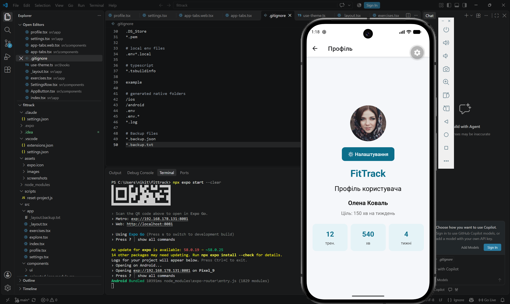
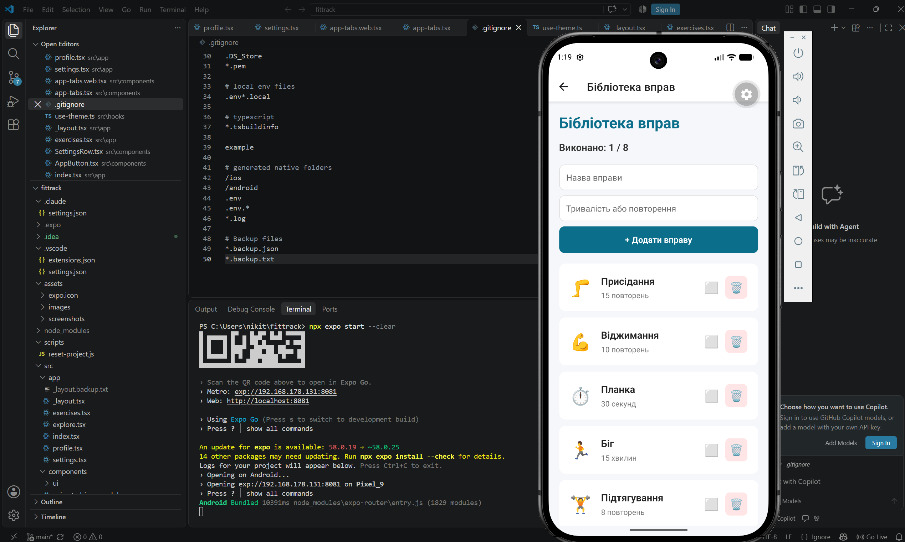

# FitTrack

Навчальний мобільний застосунок для відстеження фізичних вправ, розроблений за допомогою React Native, Expo та TypeScript.

## Функціональність

- Головний екран із навігацією.
- Профіль користувача зі статистикою.
- Бібліотека фізичних вправ на основі FlashList.
- Додавання та видалення вправ.
- Позначення виконаних вправ.
- Збереження вправ і налаштувань через AsyncStorage.
- Налаштування сповіщень.

## Технології

- React Native
- Expo
- TypeScript
- FlashList
- AsyncStorage
- Expo Router

## Запуск проєкту

1. Встановити Node.js.
2. Клонувати репозиторій.
3. Встановити залежності:

   npm install

4. Запустити застосунок:

   npx expo start

5. Відкрити застосунок через Android Emulator або сумісний Expo Go.

## Скріншоти

### Профіль користувача

### Бібліотека вправ

